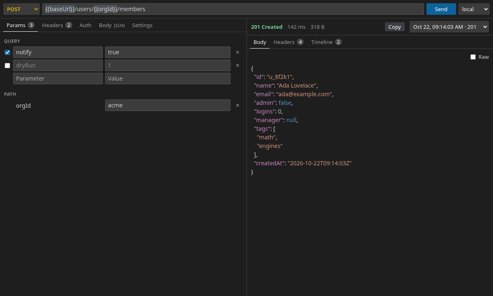

# YAML HTTP

A VS Code HTTP client where requests are plain YAML files in your repo. Open a `*.req.yaml` file in a split-screen request editor, send it, and read the response next to it. The format is small enough for coding agents to write.

## Screenshot



## Quick start

1. Install the extension, or build it yourself (see Development).
2. Open the YAML HTTP view in the activity bar and choose **New Request**, or **Import OpenAPI…**.
3. Edit the request, pick an environment (status bar or **YAML HTTP: Select Environment**) and press **Send**, or `Ctrl+Enter` / `Cmd+Enter` in the YAML text.

Try the sample in [examples/.http](examples/.http): copy it into your workspace, copy `env/local.env.example` to `env/local.env` and fill in `apiToken`.

## File layout

Everything lives under `.http/` in the first workspace folder (change it with `yamlHttp.root`).

```
.http/
  env/local.yaml          # committed: non-secret variables
  env/local.env           # git-ignored: secrets, KEY=value
  env/local.env.example   # committed: secret names only
  users/_folder.yaml      # optional: headers/auth/settings shared by users/**
  users/get-by-id.req.yaml
  .openapi/               # OpenAPI import records
  .schema/                # JSON Schemas (added by "Add Agent Instructions")
```

A request's id is its path relative to `.http/` without `.req.yaml`. The full file format is in [resources/agent-guide.md](resources/agent-guide.md). JSON Schemas for requests, folders and environments give completion and validation in the YAML text editor.

`*.req.yaml` files open in the request editor by default. Use **Open as Text** (and **Open in Request Editor** to go back) to switch.

## Environments and secrets

`env/<name>.yaml` holds non-secret `variables`. `env/<name>.env` holds secrets as `KEY=value`; it wins on a clash and must not be committed. The extension adds `env/*.env` to `.gitignore` when it creates an environment. Commit `env/<name>.env.example` to list the secret names. Use values with `{{name}}` in any string; request `pathParams` take priority over the environment.

## Auth

Set `auth` on a request or in a `_folder.yaml` (requests inherit the nearest one). Supported types: `none`, `inherit`, `basic`, `bearer`, `apiKey` (header or query) and `oauth2` (client credentials, and authorization code with PKCE). OAuth tokens are cached in VS Code SecretStorage; **Clear OAuth Tokens** removes them.

## Chaining

`{{response('auth/login', 'body.json.token')}}` takes a value from another request's last successful response in the same environment, sending that request first if there is none. An optional third argument is a max age (`'30m'`) after which it is re-sent. Paths: `body.a.b[0].c`, `body`, `headers.<name>`, `status`.

## OpenAPI import and re-import

**Import OpenAPI…** reads an OpenAPI 3.0/3.1 file or URL and creates a folder of requests, a base URL variable, and an import record in `.openapi/`. **Re-import OpenAPI** updates the generated requests from the spec and reports added, updated, removed and conflicting operations. Imported requests carry a `source` key; keep it.

## Agents

Run **YAML HTTP: Add Agent Instructions**. It writes `.http/AGENTS.md` (the format guide, [resources/agent-guide.md](resources/agent-guide.md)), copies the schemas to `.http/.schema/`, and can add a Claude Code skill at `.claude/skills/http-requests/SKILL.md`.

## Commands

| Command | Notes |
| --- | --- |
| Send Request | `Ctrl+Enter` / `Cmd+Enter` in a `*.req.yaml` text editor |
| Open as Text / Open in Request Editor | Switch between the editors |
| Select Environment | |
| Import OpenAPI… / Re-import OpenAPI | |
| New Request / New Folder / Rename / Duplicate / Delete / Refresh | Request tree |
| Clear Cookies | Clears the cookie jar |
| Clear OAuth Tokens | |
| Add Agent Instructions | |

## Settings

| Setting | Default | Description |
| --- | --- | --- |
| `yamlHttp.root` | `.http` | Folder holding requests, environments and import records, relative to the first workspace folder. |

## Security notes

- Keep secrets in `env/*.env` only. These files are git-ignored; never commit them and never put secret values in `.req.yaml` or `env/*.yaml`.
- Secret values are masked as `•••••` in the timeline, error messages and URLs; `Authorization`, `Cookie` and `Proxy-Authorization` headers are always masked.
- Response history (last 20 per request and environment) is stored in the extension's workspace storage, not in your repo. Responses are stored as received, so a response body can contain a secret the server echoed back.
- OAuth tokens live in VS Code SecretStorage.
- Disabling `verifyTls` in a request's `settings` turns off certificate checks for that request only.

## Development

```
npm install
npm test               # unit tests (vitest)
npm run test:webview   # renders the webview and writes screenshots to test/webview/out
npm run build          # bundles the extension and webview into dist/
npm run package        # builds yaml-http-0.1.0.vsix
```

## License

MIT, copyright mikeboe.
